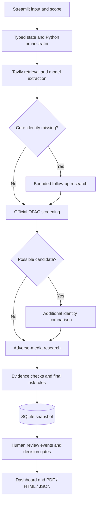

# ClearDiligence

**AI-assisted preliminary vendor and contractor due diligence.**

ClearDiligence gathers public evidence, screens company names against official US sanctions data, applies explicit risk rules, and prepares unresolved work for a human analyst. This local Python/Streamlit portfolio MVP was developed with AI coding assistance.

The design separates model-proposed findings, evidence validation, deterministic policy, and human decisions. Similar names create screening candidates; they do not automatically confirm identity or sanctions exposure.

## Capabilities

- Research company identity, business activity, location, leadership, and available registration or ownership information.
- Define fields, source families, jurisdictions, media topics, dates, and bounded research budgets.
- Screen legal names and supported aliases against official OFAC SDN records.
- Distinguish allegations, regulatory/judicial findings, unrelated namesakes, and unresolved relevance.
- Inspect source excerpts, exact queries, coverage, and workflow events.
- Record analyst reviews and gated Hold, Proceed, or Reject dispositions.
- Persist assessments and separate human events in SQLite; export PDF, interactive HTML, and JSON.
- Model illustrative analyst-capacity value using adjustable assumptions.

## Quick start

Python 3.14 is the locally verified baseline. Other versions and platforms need independent verification.

```bash
git clone https://github.com/zuhairtaha94-code/ClearDiligence.git
cd ClearDiligence
python3.14 -m venv .venv
source .venv/bin/activate
python -m pip install -r requirements-dev.txt
python -m streamlit run app.py
```

On Windows, activate with `.venv\Scripts\activate`. Open `http://127.0.0.1:8501` on the same computer. **Demo mode requires no API keys.** `requirements.lock` captures the original local environment; the requirements files are installation entry points.

## Three synthetic scenarios

Choose **New assessment → Demo**, select a scenario, and click **Begin assessment**.

| Fictional company | Expected tier | Behavior |
| --- | --- | --- |
| Cedarline Facilities Group | Low | Unrelated namesake media is excluded. |
| Meridian Campus Builders | Moderate | An unadjudicated allegation remains an allegation. |
| Atlas Infrastructure Partners | High | A possible sanctions name match triggers further identity research and human escalation. |

Every demo company, person, article, identifier, and screening record is synthetic. Demo screening is not an OFAC result. `demo://` references point to embedded fixtures.

For Atlas, inspect **Workflow log → Evidence explorer → Analyst review**. Different identifiers suggest a namesake, but ownership links remain unresolved. High does not mean confirmed sanctioned.

## Live research

Copy `.env.example` to a new `.env` and configure Tavily plus one supported model provider. Preserve any existing credential file.

```dotenv
LLM_PROVIDER=gemini
GEMINI_API_KEY=your-key
GEMINI_MODEL=your-available-model-id
TAVILY_API_KEY=your-key
```

Anthropic is supported through `LLM_PROVIDER=anthropic`, `ANTHROPIC_API_KEY`, and `ANTHROPIC_MODEL`. Select a model available to your account; configuration does not establish service health. Auto selection prefers configured Anthropic, otherwise Gemini. Official OFAC files require no paid key.

Use **New assessment → Live → Preview search plan** before external calls. An LLM key alone does not provide web retrieval. Inputs and retrieved material are sent to configured providers. Keep private client data out of portfolio demonstrations.

| Service | Actual boundary |
| --- | --- |
| Tavily | Automated public search and bounded company-page extraction. |
| Gemini / Claude | Structured extraction followed by local validation. |
| OFAC | Official SDN CSV retrieval, joins, provenance, and name matching. |
| OpenCorporates | Optional token-authenticated candidate search; mock-tested contract, no established credentialed live check. |
| TLOxp / CLEAR / Factiva | Licensed manual handoffs; no live API adapters. |
| Google | Manual corroboration links. |
| DOJ / SEC | Selected public-domain searches, not comprehensive registry/case feeds. |

## Architecture



This is bounded agentic orchestration: shared state and intermediate findings determine follow-up work. Python controls branches and policy. The model proposes extracted information; it cannot approve a vendor or write a human review.

| Module | Responsibility |
| --- | --- |
| `app.py` | Forms, navigation, progress, reviews, exports. |
| `models.py` | Typed contracts. |
| `workflow.py` / `research.py` | Orchestration and research planning. |
| `providers.py` / `recovery.py` | Retrieval, extraction, OFAC, bounded recovery. |
| `validation.py` / `risk.py` | Evidence checks and versioned policy. |
| `manual.py` / `databases.py` | Registry and specialist-source handoffs. |
| `storage.py` | Snapshots, human events, transactional gates. |
| `presentation.py` / `briefing.py` | Readable interpretation and prioritized issues. |
| `interactive_report.py` / `report.py` | HTML and PDF. |

Module paths are under `cleardiligence/` unless stated otherwise.

## Evidence and human control

- Source IDs, excerpts, values, mode boundaries, and field support are checked; unsupported proposals are quarantined.
- Verified means implemented evidence checks passed; it does not certify publisher truth.
- Missing data remains a gap. Headquarters does not establish registration; a merger announcement does not establish current ownership.
- Tiers are Low, Moderate, High, or Insufficient Information. Possible sanctions candidates require escalation without automatic confirmation.
- Required unresolved findings or manual tasks can block Proceed even with a Low machine tier.
- Human events do not overwrite the original assessment. Analyst names are self-declared; production authentication is absent.
- Gemini recovery uses ordered alternatives and bounded attempts. Backup authentication is not quota-key rotation.

## Evaluation

```bash
python scripts/evaluate.py
```

The offline suite contains 131 cases at the October 18, 2026 baseline, including typed outputs, evidence rejection, synthetic/live isolation, sanctions parsing and branching, risk rules, provider failures, review gates, persistence, reports, and Streamlit interactions. See [the evaluation summary](docs/EVALUATION.md) for packaged verification.

Provider contracts use controlled mocks. Passing tests establish selected behavior, not real-world hallucination rates, sanctions recall, legal compliance, or business savings. Historical credentialed checks are separate; private live-assessment artifacts are excluded.

A GitHub Actions workflow runs the evaluator on pushes and pull requests. Hosted success requires an actual successful Actions run.

## Limits and next steps

This MVP has no production login/RBAC, tenant isolation, durable jobs, crash checkpoints, managed encryption/retention policy, or tamper-evident audit store. Research is synchronous; interruption before save can lose work.

Screening is SDN-only and excludes ownership rules, other watchlists, comprehensive registry/court coverage, and reliable matching across all scripts. Public search cannot guarantee ownership coverage. Screening is not legal or regulatory clearance.

Priorities are authenticated approvals, recoverable jobs, protected shared storage, authoritative registry/ownership sources, expert-labeled evaluation, and contractor-specific checks. Capacity estimates are illustrative rather than measured savings.

## Documentation

- [Architecture and production roadmap](docs/ARCHITECTURE.md)
- [Demo script](docs/DEMO_SCRIPT.md)
- [Integrations and reporting](docs/INTEGRATIONS_AND_REPORTING.md)
- [Evaluation](docs/EVALUATION.md)

## Development approach

Developed with AI coding assistance through incremental implementation, synthetic cases, behavior checks, and refinements to evidence and review controls. This repository does not claim independent manual authorship of every line or deployment in a client environment.
